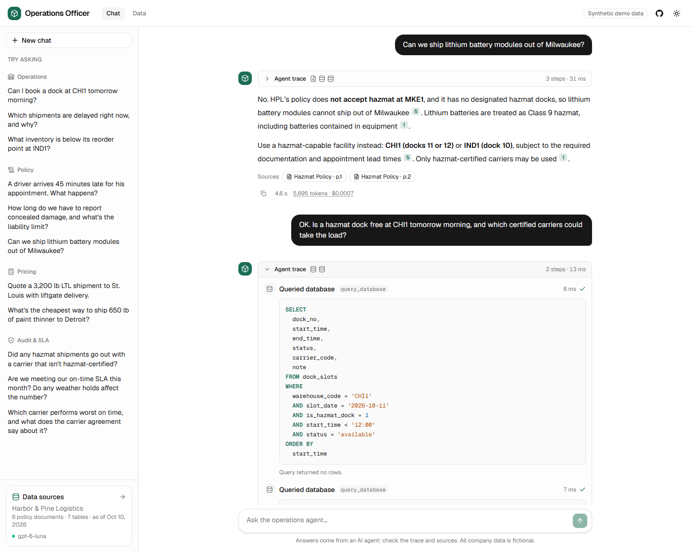
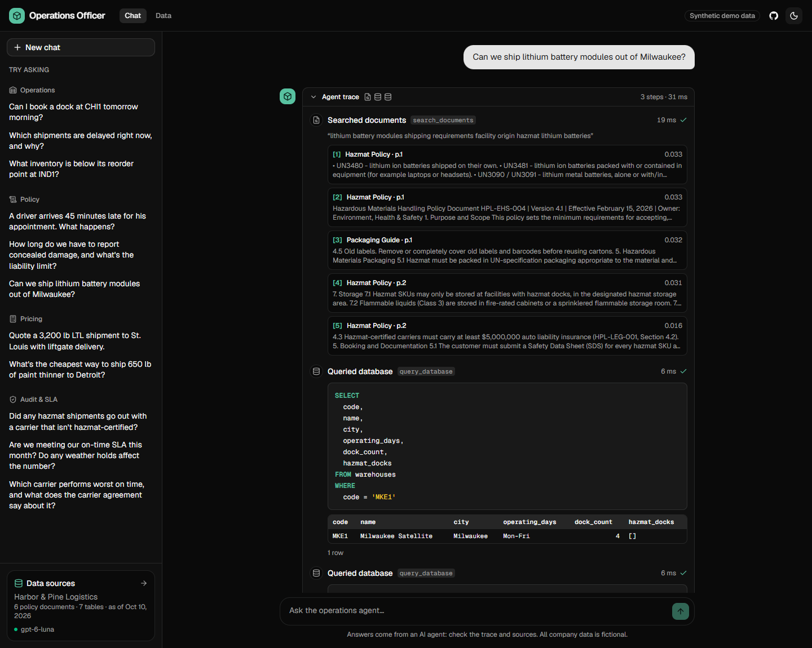
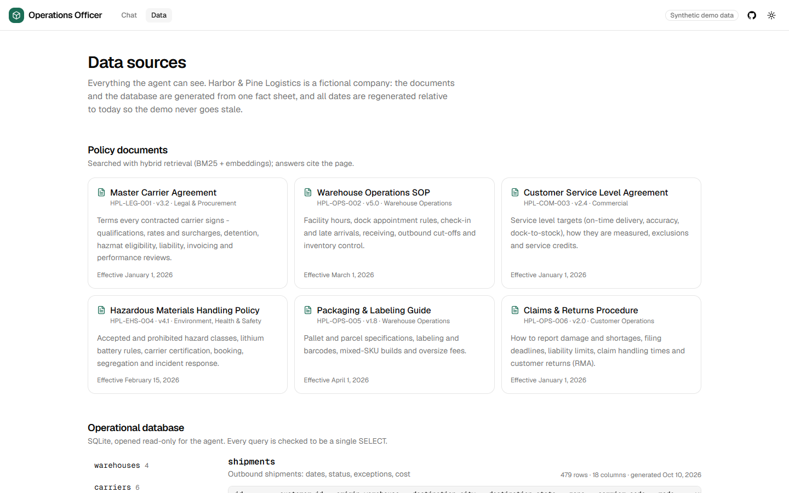
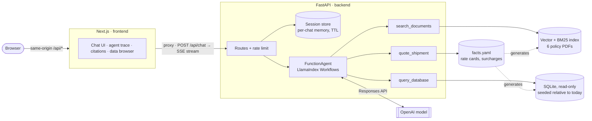

# AI Operations Officer

[](https://github.com/trigonosaurus-rgb/ai-operations-officer/actions/workflows/ci.yml)


[](LICENSE)

**An AI agent for a logistics company's operations team.** It answers questions by reading policy documents, querying the live operational database and pricing shipments, and it shows its work: every answer comes with an agent trace (tool calls, the SQL it ran, the rows it got back) and page-level citations that open the source PDF.



> **All data is synthetic.** Harbor & Pine Logistics is a fictional 3PL. Its documents and database are generated from one fact sheet, so the demo can be shared freely.

## What it does

Ask it the questions an operations coordinator gets all day:

| Question | What the agent does |
|---|---|
| *Can we ship lithium battery modules out of Milwaukee?* | Searches the hazmat policy, checks the warehouse in SQL, cites both pages it relied on |
| *Is a hazmat dock free at CHI1 tomorrow morning?* | Writes and runs a `SELECT` on `dock_slots` for tomorrow's date, which it gets from the system prompt |
| *What's the cheapest way to ship 650 lb of paint thinner to Detroit?* | Checks the hazmat rules, then gets quotes for every eligible carrier, cheapest first, from a deterministic calculator |
| *Are we meeting our on-time SLA this month?* | Reads the SLA target from the contract, computes the actual rate from shipments |
| *Delete all shipments from last week.* | Refuses: the database tool is read-only by construction, not by prompt |

Three tools, chosen by the model on each step:

- **`search_documents`**: hybrid retrieval (BM25 + embeddings, fused with RRF) over six policy PDFs; returns passages with document and page so answers can cite them.
- **`query_database`**: the model writes SQL against a compact, annotated schema; a guard lets through only a single `SELECT`, on a read-only connection, with a time and row budget. SQL errors go back to the model so it can fix its own query.
- **`quote_shipment`**: freight prices come from Python code over rate cards and surcharges, never from LLM arithmetic.

| Agent trace (dark theme) | Data browser |
|---|---|
|  |  |

## Quickstart

Requires Docker and an OpenAI API key.

```bash
git clone https://github.com/trigonosaurus-rgb/ai-operations-officer.git
cd ai-operations-officer
cp .env.example .env          # then set OPENAI_API_KEY
docker compose up --build
```

Open **http://localhost:3000**. The API and its Swagger docs are at http://localhost:8000/docs.

The first build takes a few minutes (it downloads the embedding model and bakes the document index into the image); after that the stack starts in about 10 seconds. Without an API key it still starts: documents and data are browsable, and the chat explains what's missing.

## Architecture



A chat request streams back as typed server-sent events: `tool_call` → `tool_result` (SQL, rows, citations, quote) → `token`… → `done` (sources, tokens, cost, latency) or `error`. The event schemas are Pydantic models, exported to OpenAPI and turned into TypeScript types, so the frontend and backend can't drift apart silently (CI checks both files are up to date).

## Key engineering decisions

**The model never gets write access.** Prompt instructions are not a security boundary, so the SQL tool enforces it in four independent layers: a `sqlglot` parse that allows exactly one read statement, a SQLite connection opened with `mode=ro` and `query_only`, a timeout via the progress handler, and a row cap. An injected `DROP TABLE` fails at every layer, and the tests check that it does.

**Deterministic tools for anything that must be exact.** LLMs are good at choosing what to compute and bad at computing it. Freight quotes come from the same pure Python function that generated the historical invoices in the database, so a quoted price always matches how the company actually bills.

**Retrieval returns passages, not answers.** `search_documents` hands the model raw passages with document and page metadata instead of calling a nested query engine. That removes an extra LLM call per search, and citations become structural (they come from metadata, not from the model remembering a source).

**Hybrid search, decided by an eval.** Vector search finds paraphrases ("truck shows up way after its slot"); BM25 finds exact identifiers the embedding blurs ("UN3481", "SSCC-18"). On 24 labeled queries, fusing them beat either one alone (table below), so hybrid stayed.

**One fact sheet generates all the data.** `data/company/facts.yaml` is the single source of truth: the six policy PDFs are rendered from it, and the database is seeded from it. The numbers in the documents and the rows in the database cannot contradict each other. Dates are generated relative to today with a fixed random seed, so "is there a free dock tomorrow?" always has a real answer and the demo never goes stale.

**Per-session memory behind an interface.** Each chat has its own history in a `SessionStore` (an LRU + TTL dict with a lock per session). Routes depend only on the protocol, so moving to Redis for multiple workers is a new class, not a rewrite. Memory keeps questions and final answers, not raw tool dumps, so follow-ups stay cheap.

**Small, fast container.** Embeddings run through `fastembed` (ONNX) instead of PyTorch, and the model plus the index are baked into the image at build time. The backend starts in seconds and makes no downloads at runtime.

**Testable without an LLM.** The agent is driven by a scripted mock LLM in tests, and FastAPI's dependency injection swaps real components for fakes. CI runs 137 backend tests and the frontend suite with no API key; the paid evals run on demand.

## Evaluation

LLM features need numbers, not vibes. Two eval suites live in [`backend/evals/`](backend/evals/).

**Agent eval:** 30 golden questions across policy, operations, pricing, audit, safety and multi-turn conversation. Each case is scored three ways: did the agent call the right tools, does the answer contain the required facts (including values queried live from the DB), and an LLM judge compares it to a reference answer.

| Metric | Result |
|---|---|
| **Cases passed** (routing + facts + judge) | **29/30 (97%)** |
| Tool routing accuracy | 100% |
| Fact checks (incl. live DB values) | 100% (51/51) |
| LLM judge: correct (score ≥ 4) | 97% (avg 4.77 / 5) |
| Latency p50 / p95 | 3.1 s / 6.1 s |
| Cost of the whole 30-case run | $0.018 |

Model `gpt-6-luna`, reasoning effort `low`. The one failure is worth reading: the agent computed the on-time rate correctly (94.2%) and then said "Yes" to "are we meeting the 95% SLA?". Full per-case results: [`backend/evals/results/agent.md`](backend/evals/results/agent.md).

**Retrieval eval:** 24 labeled queries, half paraphrased and half exact identifiers, k = 5.

| Retriever | hit@1 | hit@5 | MRR |
|---|---|---|---|
| Vector (bge-small) | 58% | 83% | 0.70 |
| BM25 | 58% | 83% | 0.67 |
| **Hybrid (RRF)** | **62%** | **88%** | **0.73** |

Per query: [`backend/evals/results/retrieval.md`](backend/evals/results/retrieval.md).

```bash
cd backend
uv run python -m evals.retrieval   # free, no API key
uv run python -m evals.run         # ~50 s, about two cents
```

## Tech stack

| Layer | Tools |
|---|---|
| Agent | LlamaIndex `FunctionAgent` (Workflows), OpenAI Responses API |
| Retrieval | fastembed `bge-small-en-v1.5` (ONNX), BM25, reciprocal rank fusion |
| Data | SQLite, `sqlglot` SQL guard, YAML fact sheet, PDFs rendered with `fpdf2` |
| API | FastAPI, Pydantic v2, server-sent events, `pydantic-settings`, structured JSON logs |
| Frontend | Next.js 16 (App Router), React 19, TypeScript, Tailwind CSS 4, shadcn/ui, `openapi-typescript` |
| Quality | pytest, Vitest, Ruff, ESLint, golden-set evals with LLM judge, GitHub Actions |
| Packaging | uv, multi-stage Dockerfiles, Docker Compose with health checks |

## Local development

Without Docker: Python 3.12 with [uv](https://docs.astral.sh/uv/), and Node 24.

```bash
# Backend: http://localhost:8000
cd backend
uv sync
uv run uvicorn app.main:app --reload

# Frontend: http://localhost:3000 (in a second terminal)
cd frontend
npm install
npm run dev
```

On first start the backend seeds the database and builds the document index into `var/` (git-ignored). Useful commands:

| Command (from `backend/`) | What it does |
|---|---|
| `uv run pytest` | Backend tests, no API key needed |
| `uv run ruff check . && uv run ruff format .` | Lint and format |
| `uv run python -m scripts.ask "question"` | Ask the agent from the terminal and watch the event stream |
| `uv run python -m scripts.seed_db` | Rebuild the database for today |
| `uv run --group docs python -m scripts.build_docs` | Re-render the policy PDFs from `facts.yaml` |
| `uv run python -m scripts.export_openapi` | Export the API contract, then `npm run gen:api` in `frontend/` |

Frontend: `npm test`, `npm run lint`, `npm run typecheck`, `npm run build`.

Every setting in [`backend/app/config.py`](backend/app/config.py) can be overridden with an environment variable or `.env`: model, reasoning effort, CORS origins, rate limit, session TTL, log format and more. See [`.env.example`](.env.example).

## Project structure

```
backend/
  app/
    agent/          FunctionAgent setup, prompts, session store, SSE event models
      tools/        search_documents · query_database (SQL guard) · quote_shipment
    api/            routes, request/response schemas, dependencies, rate limit
    data/seed.py    deterministic, date-relative database seed
    domain/         fact sheet loader, pricing engine
    config.py       all settings, from env
  evals/            golden cases, agent + retrieval eval runners, results
  tests/            pytest suite (mock LLM, no network)
  scripts/          seed, build index, render PDFs, export OpenAPI, CLI chat
frontend/
  app/              pages: chat, data browser, healthz
  components/chat/  message, agent trace, SQL block, citations, composer
  lib/api/          generated API types, SSE client, server-side fetches
data/
  company/facts.yaml   single source of truth
  docs_src/            Markdown + Jinja templates for the policies
  docs/                rendered PDFs (committed)
docker-compose.yml
```

## Roadmap

- **Human-in-the-loop actions:** a `book_dock_slot` tool where the agent proposes a booking and the user confirms it in the UI before anything is written.
- **Observability:** traces in Langfuse or Arize Phoenix.
- **Scale-out:** Redis-backed sessions and rate limits for more than one worker.

## License

[MIT](LICENSE). All company names, people, addresses and figures in the data are fictional.
